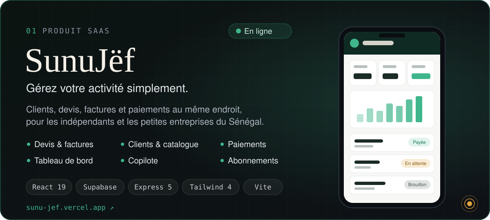
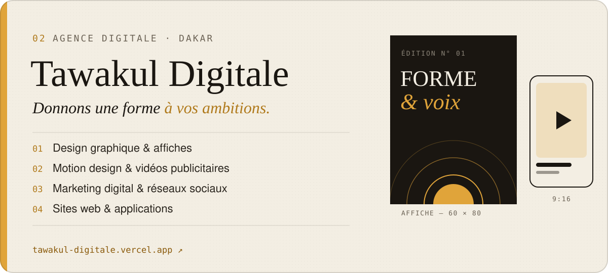
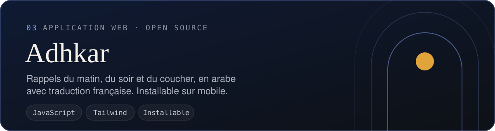

 

  <a href="https://sunu-jef.vercel.app"><b>SunuJëf</b></a>
  &nbsp;·&nbsp;
  <a href="https://tawakul-digitale.vercel.app"><b>Tawakul Digitale</b></a>
  &nbsp;·&nbsp;
  <a href="mailto:moryndour493@gmail.com"><b>Me contacter</b></a>

 

> **J'apprends le génie logiciel en construisant de vrais produits.**
> Étudiant en deuxième année de Licence à l'ISI Dakar, je conçois, je développe et je mets en ligne
> des solutions numériques pensées pour des besoins concrets, ici, au Sénégal.

 

## À propos

Je m'appelle **Mory Ndour**. Je suis en **Licence 2 Génie logiciel à l'ISI Dakar** et je m'intéresse
à tout ce qui se passe entre une idée et un produit utilisé : comprendre le besoin, concevoir l'interface,
structurer les données, écrire le code, mettre en ligne, puis améliorer.

Je n'attends pas la fin de mes études pour construire. **SunuJëf** est né d'un constat simple :
beaucoup d'indépendants et de petites entreprises gèrent encore leurs devis et leurs factures à la main.
**Tawakul Digitale** prolonge la même envie, du côté de l'entreprise : aider des marques à exister en ligne
avec du design, de la vidéo et du web.

Je suis développeur en formation, avec l'ambition de devenir un ingénieur capable de concevoir des produits
utiles de bout en bout. Ce profil montre où j'en suis, honnêtement, et la direction que je prends.

 

## Ce que je construis

| | Projet | En une phrase |
|:-:|---|---|
| `01` | **[SunuJëf](https://sunu-jef.vercel.app)** | Mon application SaaS de gestion commerciale, conçue, développée et mise en ligne par moi. |
| `02` | **[Tawakul Digitale](https://tawakul-digitale.vercel.app)** | Mon agence digitale à Dakar : design graphique, motion, marketing digital et web. |
| `03` | **[Adhkar](https://github.com/moryndour/Application-de-ahkar)** | Une application web de rappels quotidiens, au code ouvert. |

 

## Projets à la une

### SunuJëf &nbsp;· Produit SaaS · [sunu-jef.vercel.app](https://sunu-jef.vercel.app)

SunuJëf est une application de gestion pour les **entrepreneurs, indépendants et petites entreprises**.
Elle réunit tout le cycle commercial dans un seul espace, utilisable depuis un téléphone :

- **Clients et catalogue** : fiches clients, produits et services avec leurs tarifs
- **Devis et factures** : création, suivi des statuts, conversion d'un devis accepté en facture, export PDF, partage WhatsApp
- **Paiements** : enregistrement des règlements, montants encaissés et restant dus
- **Tableau de bord** : une vue d'ensemble de l'activité et du chiffre d'affaires du mois
- **Copilote** : prépare un devis à partir d'une phrase écrite en français
- **Abonnements** : plans Starter, Pro et Agence (jusqu'à 5 utilisateurs), essai gratuit, paiement en ligne

**Sous le capot** : React 19, React Router, Tailwind CSS 4 et Vite côté interface ;
Supabase (PostgreSQL, authentification) pour les données ; une API Node.js / Express 5 pour les paiements,
avec vérification des webhooks ; déploiement sur Vercel.

Code source privé. L'application et sa page de présentation sont publiques.

 

### Tawakul Digitale &nbsp;· Agence digitale · [tawakul-digitale.vercel.app](https://tawakul-digitale.vercel.app)

Tawakul Digitale est l'agence que j'ai fondée à Dakar. Elle accompagne les entreprises et les organisations
dans leur communication visuelle et leur développement numérique :

- **Sites web et applications**
- **Design graphique** : affiches, visuels pour les réseaux sociaux, identité visuelle
- **Motion design et vidéos publicitaires**, notamment au format vertical
- **Marketing digital** et gestion des réseaux sociaux

J'ai développé le site de l'agence avec **Astro, TypeScript et Tailwind CSS** : pages par expertise pensées
pour la recherche locale, portfolio avec l'étude de cas de SunuJëf, formulaire de contact, sitemap et
données structurées.

Code source privé. Le site est public.

 

**[Adhkar](https://github.com/moryndour/Application-de-ahkar)** · Une application web en JavaScript natif :
une cinquantaine d'invocations du matin, du soir et du coucher, en arabe avec la traduction française,
le nombre de répétitions et le hadith associé. Recherche, favoris, taille du texte réglable, installation sur l'écran d'accueil.

 

## Stack technique

Uniquement des technologies présentes dans le code de mes projets.

| Domaine | Technologies | Où |
|---|---|---|
| **Frontend** | React · React Router · Astro · Tailwind CSS · JavaScript · TypeScript · HTML / CSS | SunuJëf, Tawakul Digitale, Adhkar |
| **Backend** | Node.js · Express · JWT | API de paiement de SunuJëf |
| **Database** | Supabase (PostgreSQL, Auth) · migrations SQL | SunuJëf |
| **Tools & Workflow** | Git · GitHub · Vite · npm | Tous mes projets |
| **Deployment** | Vercel | SunuJëf, Tawakul Digitale |

 

## Mon parcours

| Étape | Ce que j'en retiens |
|---|---|
| **Les bases du web** | Mes premières pages et des exercices d'intégration HTML / CSS. |
| **JavaScript** | Les fondamentaux en travaux pratiques : fonctions, objets, tableaux, déstructuration. |
| **Adhkar** | Une application complète, utile au quotidien et pensée pour le mobile. |
| **Licence Génie logiciel, ISI Dakar** | Aujourd'hui en deuxième année : méthode, conception et rigueur. |
| **SunuJëf** | Le passage au full-stack : interface React, base de données, API, paiements, mise en ligne. |
| **Tawakul Digitale** | Le code au service d'un projet d'entreprise, aux côtés du design et de la vidéo. |

**Ce que je vise ensuite** : faire grandir SunuJëf auprès de vrais utilisateurs, livrer les premiers
projets de Tawakul Digitale et continuer à progresser en architecture logicielle et en qualité de code.

 

## Activité GitHub

Mon calendrier de contributions se trouve juste en dessous de ce profil.
Une grande partie de mon travail se fait dans les dépôts privés de SunuJëf et de Tawakul Digitale :
c'est pourquoi je les présente ici à travers leurs sites publics.

 

## Restons en contact

Un projet, un stage, une collaboration ou une question sur SunuJëf ?

| Canal | Lien |
|---|---|
| ✉️ **E-mail** | [moryndour493@gmail.com](mailto:moryndour493@gmail.com) |
| 🧾 **SunuJëf** | [sunu-jef.vercel.app](https://sunu-jef.vercel.app) |
| 🎨 **Tawakul Digitale** | [tawakul-digitale.vercel.app](https://tawakul-digitale.vercel.app) |

 

Dakar, Sénégal · <i>j'apprends, je construis, j'entreprends</i>

